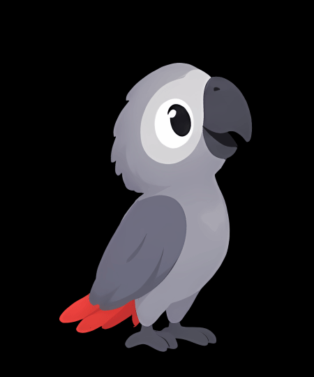
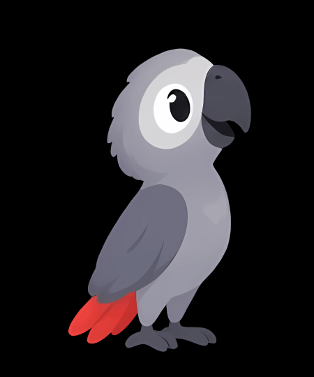
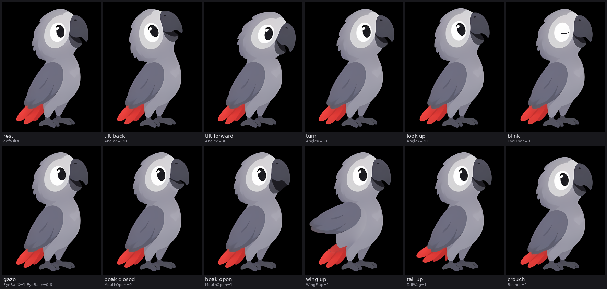

# kakak-animation

An African grey parrot, rigged and animated from a single illustration with
[Rev2D](https://github.com/RevStudio/Rev2D), the text-first 2D rigging toolkit in the spirit of
Live2D and Spine. The result is an ordinary Rev2D model, `parrot/parrot.r2d.json`, plus its layer
textures. You can open it in the Rev2D editor, render it, or export it to Spine or Live2D.

| idle | curious | talk | dance | flap |
| :-: | :-: | :-: | :-: | :-: |
|  |  |  |  |  |

A 25 s showcase with all of them is in [`renders/showcase.mp4`](renders/showcase.mp4) (900 x 1080).



## Open it in Rev2D

```bash
git clone https://github.com/RevStudio/Rev2D
```

```bash
cd Rev2D && npm install
```

```bash
node bin/rev2d.js edit ../kakak-animation/parrot/parrot.r2d.json
```

The editor (`http://127.0.0.1:4777`) plays the animations and has a slider for every parameter.
The same model works headless:

```bash
node bin/rev2d.js gif ../kakak-animation/parrot/parrot.r2d.json -o dance.gif --anim dance --warmup 10 --scale 1.5
```

```bash
node bin/rev2d.js render ../kakak-animation/parrot/parrot.r2d.json -o curious.png --param AngleZ=-20,EyeBallY=0.8 --scale 2
```

Animations layer like in Rev2D generally. For example, `--anim idle --anim talk,add` chatters while
idling, and `--anim dance --anim blink,once,start=0.7` adds an extra blink.

## Animations

| Animation | Length | What happens |
| --- | --- | --- |
| `idle` | 6 s loop | breathing, a slow lean, small head turns and tilts, a glance, a beak click, two blinks |
| `talk` | 2 s loop | the beak chatters with small nods; keys sit around the defaults, so it also works as an `add` layer |
| `dance` | 2 s loop | a head-bobbing dance at 120 bpm: head forward and down on every beat with a knee bounce, body sway, tail wag, wing pops on 2 and 4, chirps on 1 and 3 |
| `curious` | 4 s loop | tilts the head back to look up, blinks, then tilts forward and leans in to peer down, double-blinks |
| `flap` | 2.4 s loop | an excited squawk: crouch, hop with the wing fluttering, beak wide open, landing squash |
| `blink` | 0.3 s | one blink, for playing `once` over anything |

Every loop closes seamlessly (`rev2d analyze --warmup 10`: 0 % pixel difference at the seam), and
the physics never clamps.

## Parameters

| Parameter | Range (default) | Controls |
| --- | --- | --- |
| `AngleX` | -30..30 (0) | head turn, a pseudo-3D yaw: the eye and beak slide, the silhouette barely moves |
| `AngleY` | -30..30 (0) | nod: > 0 looks up (the beak rises) |
| `AngleZ` | -30..30 (0) | head tilt about the neck, clockwise for > 0 (18 deg at the ends) |
| `HeadX`, `HeadY` | -1..1 (0) | head bob forward / back (8 px) and up / down (6 px) |
| `EyeOpen` | 0..1 (1) | blink: the lid closes down to a curved line |
| `EyeBallX`, `EyeBallY` | -1..1 (0) | gaze |
| `MouthOpen` | 0..1 (0.3) | lower mandible: 0 closed, 0.3 as drawn, 1 wide open |
| `BodyAngleX` | -10..10 (0) | lean about the feet |
| `Breath` | 0..1 (0) | the chest widens, the upper body rises |
| `Bounce` | -1..1 (0) | knees: > 0 crouch and squash, < 0 stretch |
| `Hop` | 0..1 (0) | jump, 24 px |
| `WingFlap` | 0..1 (0) | the wing lifts about the shoulder (34 deg) |
| `TailWag` | -1..1 (0) | tail swing (14 deg) |
| `TailSway`, `WingSway` | -1..1 (0) | physics outputs: the tail and wing lag behind body motion |

The visible eye is the parrot's left eye. Signs follow Rev2D's (Live2D's) conventions.

## How it is built

The illustration is a 188 x 425 JPEG on black. Everything below is reproducible from
`source/parrot.jpg`.

1. **Upscale.** `tools/upscale_esrgan.py` runs Real-ESRGAN x4 (anime, 6 blocks) in plain numpy,
   giving `source/parrot_x4.png` at 752 x 1700. The clean edges matter for cutting layers.
2. **Layers.** `tools/make_layers.py` pulls a soft alpha matte off the black background and cuts
   the picture into `base`, `head`, `wing`, `tail`, `upperBeak`, `mandible` and `pupil`. It paints
   in what each moving piece hides: the body and rump behind the wing, the tail's root under the
   wing and the leg, chin feathers behind the mandible, and the white eye ring behind the pupil.
   Textures are 4 px per model px.
3. **Rig.** `tools/build_rig.py` writes the model. One continuous lattice (`bodyWarp`, 30 x 36)
   carries the head, neck, body and legs. The head motions, lean, bounce, breath and hop are smooth
   offset fields on it, so the neck bends and never tears. Nested lattices swing the wing
   (shoulder), tail (root) and mandible (corner of the beak). The inside of the beak is a vector
   path that rides on the mandible. A hidden vector path masks the pupil as the lids. Pendulum
   physics drives the tail and wing follow-through.
4. **Animations.** `tools/animations.py` keys parameters only, never bones or physics outputs, so
   the motions transfer to any rig with the same parameter ids.
5. **Previews.** `tools/render_previews.py` renders with `rev2d frames` and encodes with ffmpeg.

To rebuild everything (Python 3 with numpy and Pillow, Node 22+, ffmpeg):

```bash
python3 tools/make_layers.py && python3 tools/build_rig.py
```

```bash
node ../Rev2D/bin/rev2d.js validate parrot/parrot.r2d.json
```

```bash
python3 tools/render_previews.py --rev2d ../Rev2D
```

The model file is written in Rev2D's own JSON layout, so saving it from the editor gives a clean
diff. Edits in the editor are overwritten the next time `build_rig.py` runs, so put lasting
changes into the scripts.

## Checks

- `rev2d validate`: 0 errors, 0 warnings.
- The rest pose rendered by Rev2D matches the upscaled illustration within a mean of 0.35/255 per
  pixel. The only differences are antialiased edges and the vector inside of the beak.
- Each parameter was swept to both ends, and the head extremes in combination, for tears, folds and
  uncovered gaps (`rev2d sheet --sweep`).
